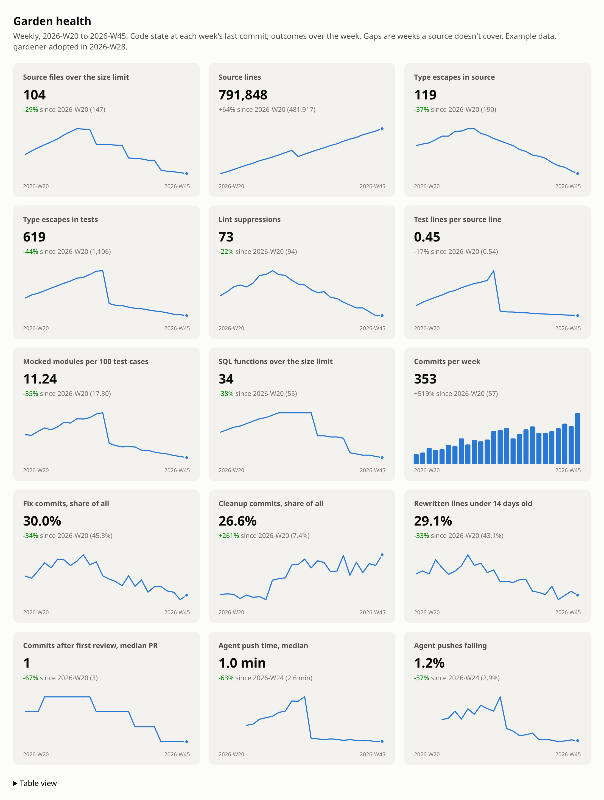

# gardener

When agents write most of your code, the codebase changes faster than anyone can read it.
Every PR can pass review and the whole can still get worse: files swell, fixes pile onto
code written last week, the test suite turns into a mirror of the implementation, and the
loop your agents work in gets slower. You only notice once everything is harder.

`gardener` measures that drift from git history alone. It tells you where the codebase
stands, which parts keep needing repair, and whether a cleanup you shipped actually helped.

```bash
npx repo-gardener history --weeks 26 --html garden.html
```

<picture>
  <source media="(prefers-color-scheme: dark)" srcset="https://raw.githubusercontent.com/subsy/gardener/main/docs/garden-dark.png">
  
</picture>

_Example data, not a real repository: a team that starts using gardener in week 28. The steps are single cleanup PRs (splitting large files, deleting tests that only restated the code, scoping the pre-push checks). The slopes are habits: a ratchet on type escapes, and a standing cleanup lane._

The name comes from [Lauren Tan (poteto)](https://x.com/poteto/status/2090546476464451907):
every team needs a gardener, someone quietly watching the stream of PRs, noticing the
smells, and pulling the weeds (lint suppressions creeping like ivy) before slop takes over.
Theo then made the case at length in "[Coding isn't about code anymore](https://www.youtube.com/watch?v=GtJKFhztgdM)":
with agents writing the code, the engineer's job is keeping the garden healthy, which means
pulling weeds as they appear, fixing what made them grow, and putting stakes in that steer
new growth the right way. You can't tend what you can't see, and gardener is the seeing part.

## Contents

- [Quick start](#quick-start)
- [What to do with it](#what-to-do-with-it)
- [Using it with your coding agent](#using-it-with-your-coding-agent)
- [Why these measures](#why-these-measures)
- [What it doesn't do](#what-it-doesnt-do)
- [Adapting it to your codebase](#adapting-it-to-your-codebase)
- [Commands](#commands)
- [Measures, exactly](#measures-exactly)
- [Configuration](#configuration)
- [How it works](#how-it-works)

## Quick start

Run these at the root of any git repository. Nothing is installed in the repo and nothing
is uploaded.

```bash
npx repo-gardener snapshot                   # where the code stands today
npx repo-gardener hotspots --days 60         # what keeps breaking
npx repo-gardener history --weeks 12 --html garden.html   # how it got here
```

Open `garden.html` in a browser: one small chart per measure, a green or red change since
the first week, and a table view. It follows your system's light or dark setting; `--theme dark`
or `--theme light` fixes it.

For the rest of the picture, add the optional sources:

- `--github` adds review load per merged PR. It needs the [GitHub CLI](https://cli.github.com/), signed in.
- `--transcripts` adds how long your agents' `git push` takes (pre-push checks included)
  and how often it fails. It reads Claude Code and Codex session logs on your machine.

To use the `gardener` command directly, install it with `npm i -g repo-gardener`. It needs
Node 22.5+ and git 2.36+.

## What to do with it

### 1. Get a baseline before you change anything

```bash
gardener history --weeks 26 --github --transcripts --html garden.html
```

Look for lines that only go one way. Typical findings:

- Source lines doubling while cleanup commits stay under 10% of the total.
- More and more files over 800 lines, each one a place agents will keep re-reading and re-breaking.
- Fixes making up half of all commits for weeks at a time.
- Agent push time creeping from seconds to minutes.

None of these is a verdict on its own. Together they tell you whether the garden is growing
or getting overgrown. Keep the HTML: it's the "before" for everything you do next.

### 2. Pick what to clean, by evidence

```bash
gardener hotspots --days 60 --limit 20
```

Hotspots ranks files by fix commits × √(lines). A file at the top keeps needing repair and is
big enough that each repair is expensive. That's where cleanup pays back fastest. Two
patterns worth knowing:

- **The god file:** thousands of lines, most of its commits are fixes, and a spec file even
  bigger than it is. Split it by responsibility.
- **The shared list:** a config or registry file that every feature edits by hand. Its fixes
  are usually "forgot to add X here too". Generate it from one source instead.

### 3. Ship the cleanup, then check whether it helped

```bash
gardener compare 1234 --days 14     # a merged PR number (needs gh), or a commit
```

`compare` shows the change in code state, then fixes and rework on the files the PR
touched, 14 days before against 14 days after. If the after window hasn't closed yet, it
says "still measuring". Run it again later.

Here it is on [T3 Code](https://github.com/pingdotgg/t3code)'s PR that deleted half its tests:

```console
$ gardener compare 22557 --days 14
#22557 test: delete 11k low-signal tests so CI runs faster and flakes less: improved

Code state
Measure                     Before   After    Change
Test lines                  733,398  482,089  -251,309
Test cases                  13,163   6,373    -6,790
Mocked modules              1,185    799      -386

Outcomes on the touched files
Measure                            Before          After
Fix commits touching these files   1,056           1,046
Rewritten lines under 14 days old  32.8% of 7,121  19.8% of 9,826
```

Half the test suite went, and fixes on those files didn't rise. That's the evidence the
tests weren't catching much. The same repo's history then shows test cases climbing back
from 6,563 to 8,781 within two weeks. A single cleanup doesn't stay done, which is why the
next step exists.

### 4. Check in every week

```bash
gardener window --days 7 --github --transcripts
```

A one-screen summary of the last week: fix and cleanup share, rework, review rounds, push
time. Schedule it, or have an agent run it and act on it (see below). What you're watching
for is the weeds growing back.

### 5. Fix the cause, then measure the fix

When the same kind of fix keeps showing up, the cause is usually in the codebase: a
misleading example agents copy, a missing type, a list someone has to remember to update.
Fix that, then use `compare` on the fix. Whether the repairs stopped is the only proof that
counts.

## Using it with your coding agent

gardener is built to be run by agents as much as by people. The output is plain text that
reads well in a terminal, and `--json` gives agents something to parse. Some prompts that
work well with Claude Code or Codex:

**Top 10 things to work on**

> I want the ten pieces of cleanup work that would most improve this codebase, ranked.
>
> Gather evidence first, and don't change any code:
> 1. `npx repo-gardener snapshot`, `npx repo-gardener hotspots --days 30 --limit 30` and
>    `npx repo-gardener history --weeks 12 --github --transcripts`.
> 2. For the ten hottest files, read the titles of their recent fix commits
>    (`git log --since='60 days ago' --format='%s' -- <file>`) and group them by what went wrong.
> 3. Profile the tests: the largest spec files, the files with the most mocked modules, and
>    the files where most assertions only check that a mock was called.
>
> Then rank ten pieces of work by how much repair work each would prevent. Group files that
> break for the same reason into one item. For each give: the evidence (numbers and file
> paths), what to do, how big it is, what could go wrong, and the exact `gardener compare` or
> history measure that will show whether it worked. Include an item only if the evidence
> supports it, and say what you looked for and didn't find. Don't recommend deleting a test
> without saying what it fails to protect.

**Weekly garden report**

> Run `npx repo-gardener window --days 7 --github --transcripts` and
> `npx repo-gardener hotspots --days 30 --limit 10`. Compare against last week's numbers in
> `docs/garden-log.md` if it exists. Tell me in five lines what got better, what got worse,
> and the one file you'd clean next and why. Don't change any code.

**Plan a cleanup from evidence**

> Run `npx repo-gardener hotspots --days 60 --json`. Take the top file. Read it and its
> recent fix commits (`git log --format='%h %s' -- <file> | head -40`). Group the fixes by
> what went wrong. Propose a split or a structural fix that would have prevented most of
> them, as a plan with the new files and what moves where. Don't write code yet.

**Prove a cleanup worked**

> Run `npx repo-gardener compare <PR number> --days 14`. If the result is "still measuring",
> tell me when the after window closes and stop. Otherwise explain the result in plain words,
> including what it can't tell us. It shows what moved on those files, not what caused it.

**Find the stem of a recurring weed**

> These PRs all fixed the same kind of bug: #… #… #…. For each, find what in the codebase
> made the mistake easy: the example the author copied, the doc that misled them, the type
> that allowed it. Propose one change that removes the cause for all of them, then the
> `gardener compare` I should run after it ships.

**Investigate a slow agent loop**

> `npx repo-gardener history --weeks 8 --transcripts` shows agent push time rising. Find
> which pre-push steps got slower and when, using git history of the hook and its scripts.
> Propose the smallest change that brings a push back under a minute.

**Rules to give your agent alongside**

Add something like this to your `AGENTS.md` or `CLAUDE.md`. Agents optimise whatever
you measure:

```markdown
## Garden health
- Don't split a file just to get under the 800-line limit: a split has to follow
  responsibilities, or the fixes just move to the new files.
- Never delete a test only to improve a number; delete tests that mirror the
  implementation or check things no code path can do.
- Fix shares and rework are what count. If a cleanup doesn't reduce them on the files
  it touched (`gardener compare`), say so; don't claim it helped.
```

## Why these measures

Each measure is here because it's cheap to compute from git, hard to fake for long, and
points at a cause you can fix. Each can also mislead you, and the table says how.

| Measure | Why it's here | How it can mislead |
|---|---|---|
| Files over 800 lines | Big files are where agents lose the thread: they read part, change part, break the rest. Most hotspots are big files. | Generated or data files. Add them to `ignore`. |
| Type escapes | Every `as any` or `@ts-expect-error` is a place the type system was switched off, usually to make an agent's code compile. A rising count in tests means mocks are being forced into shape. | It's a text match, so mentions in comments count too. Watch the trend, not the absolute number. |
| Lint suppressions | Each one is a rule someone decided didn't apply. They creep in one PR at a time. | Some suppressions are legitimate. A sudden jump is the signal. |
| Test weight | Test lines per source line, and mocked modules per 100 test cases. Mock-heavy suites restate the implementation and break on every refactor. | Some code genuinely needs mocks. Compare against your own history, not an ideal. |
| SQL function size | Long stored procedures get rewritten in full by every migration that touches them, so each change is a big risky diff. | Only dollar-quoted bodies are measured. |
| Fix share | The share of work spent repairing rather than building. Sustained high values mean the code is fighting back. | Depends on commit titles: it reads `fix:` prefixes and titles starting "Fix …". |
| Cleanup share | Refactors plus any commit that removed more than it added. If this stays near zero while the code doubles, nobody is weeding. | A big feature removal counts as cleanup. |
| Rework | Of the lines commits rewrote, the share written in the previous 14 days. High rework means code is being written, then immediately rewritten: churn without progress. | Early-stage features legitimately churn. Look at the fix-only variant. |
| Commits after first review | How many rounds a PR goes through after review starts. Rising rounds mean reviewers keep finding the same kinds of problems. | Some teams push small fixups by habit. |
| Agent push time | Agents feel slow feedback loops harder than people do, and wait on them more often. A slow pre-push or CI limits how much work you can run in parallel. | It includes the pre-push hook, so a hook that runs more checks on purpose shows up here too. |

## What it doesn't do

It's deliberately small. Knowing the limits stops you from reading too much into it.

- **It doesn't judge code quality.** No complexity scores, no "maintainability index", no
  AI review. It counts things git can prove.
- **It doesn't show cause.** `compare` shows what moved on the files a change touched. Other
  work lands in the same weeks, so treat "improved" as evidence, not proof.
- **It isn't a CI gate (yet).** There's no ratchet that fails a build when a number goes up,
  and no PR comment. You can build either from `--json`.
- **It doesn't run anything.** No tests, no builds, no coverage. It reads git objects and,
  when asked, GitHub and local transcripts.
- **It only knows some languages well.** The defaults are tuned for TypeScript and
  JavaScript. Other languages work for size, churn, hotspots and rework; type-escape and
  test patterns need configuring (see below).
- **It only follows the first-parent history of one branch**, the way squash-merge teams
  work. Merge-commit-heavy histories still work but read coarser.
- **Review data is GitHub only, and transcripts are Claude Code and Codex only.** Without
  them, those measures read `Unmeasured`.
- **It doesn't fix anything.** That's your agents' job. gardener tells them where to look
  and whether it worked.

A measure that has no data for a week, or too little to mean anything (fewer than 5 commits,
fewer than 100 rewritten lines), reads `Unmeasured`. It never reads zero.

## Adapting it to your codebase

Treat gardener as a starting point. The measures that matter most to your codebase are
probably ones only you know: Theo's team watched the bytes their wire protocol sent per
thread. Ways to fit it to your context, from least to most effort:

**1. Tell it what not to count.** Generated code, vendored data and lockfiles distort
everything. Files headed `@generated`, and anything under `generated/`, `_generated/` or
`*.gen.*`, are skipped already.

```json
{
  "ignore": ["packages/fixtures-data/**", "src/proto/**"],
  "churnIgnore": ["public/locales/**", "CHANGELOG.md"]
}
```

`churnIgnore` is for files every change touches (translations, registries). They still
count for size, but they'd drown out the hotspot list.

**2. Teach it your language.** For a Python codebase:

```json
{
  "code": ["**/*.py"],
  "tests": ["**/test_*.py", "**/*_test.py", "tests/**"],
  "patterns": {
    "typeEscapes": { "type: ignore": "#\\s*type:\\s*ignore", "Any": "\\bAny\\b" },
    "suppressions": { "noqa": "#\\s*noqa", "pylint": "pylint:\\s*disable" },
    "testCases": "^\\s*def test_",
    "mockModules": "\\b(?:mock\\.patch|patch)\\(",
    "callAssertions": "\\.assert_called\\w*\\(",
    "assertions": "\\bassert\\b"
  }
}
```

**3. Move the limits.** `largeFileLines` (800), `reworkDays` (14), `sharedFileShare` (5%),
`minCommits` and `minReworkLines` are all configurable. Choose them for your codebase,
then leave them alone so the history stays comparable.

**4. Add your own stakes.** gardener doesn't run custom metrics yet. Until it does, keep the
number you care about (bundle size, query count, wire bytes) in a small script that prints
it, and have your agent run both. If you build something general, open a PR.

## Commands

| Command | What it answers | Useful flags |
|---|---|---|
| `snapshot [rev]` | What state is the code in at this commit? Largest files, most-redefined SQL functions. | any commit, tag or branch |
| `window` | How did the last N days go? | `--days 7`, `--github`, `--transcripts` |
| `hotspots` | Which files keep needing repair? | `--days 60`, `--limit 20` |
| `compare <pr or commit>` | Did this change help the files it touched? | `--days 14`, `--markdown` for a PR comment |
| `history` | How has everything moved, week by week? | `--weeks 26`, `--html <file>`, `--theme dark`, `--github`, `--transcripts` |

Every command takes `--json`, `--branch <ref>`, `--config <file>` and `--no-cache`.

## Measures, exactly

**Code state, per commit**

| Measure | Definition |
|---|---|
| Source and test lines | Code files matching `code`, split by `tests`. Ignored and generated files are left out. |
| Files over the size limit | Source files longer than `largeFileLines`, and the lines they hold. |
| Type escapes | Matches of each `patterns.typeEscapes` regex, in source and tests separately. |
| Lint suppressions | Matches of each `patterns.suppressions` regex. |
| Test weight | Matches of `testCases`, `mockModules`, `callAssertions` and `assertions` in test files. |
| SQL | Migration count, and each function at its latest definition (replaying migrations in order, with drops applied, overloads kept apart), counted when longer than `largeFunctionLines`. |

**Outcomes, per window**

| Measure | Definition |
|---|---|
| Fix share | First-parent commits typed `fix`, by conventional prefix or leading verb. |
| Cleanup share | `refactor` commits plus other commits that deleted more than they added. |
| Rework | Lines rewritten in existing files whose `git blame --since` origin is within `reworkDays`, over an even sample of up to `reworkSample` commits. |
| Commits after first review | Per merged PR, commits after its first review, from its last 40 commits. PRs whose 40 all follow the review are left out. |
| Agent push time | Foreground `git push` calls from Claude Code transcripts and Codex sessions in this repository, deduplicated across resumed sessions. |

**Compare** puts touched files that `sharedFileShare` of all commits also change to one
side and lists them. A local branch that hasn't been fetched since the after window closed
reads `unmeasured` until you fetch it.

## Configuration

Optional: `gardener.config.json` at the repository root. Lists extend the defaults in
[`src/config.mjs`](src/config.mjs); everything else replaces them.

| Key | Meaning |
|---|---|
| `branch` | History to measure. Default: the remote's default branch, else `HEAD`. |
| `code`, `tests`, `ignore` | Globs for code, which of it is tests, and what is never measured. |
| `churnIgnore` | Measured for size, left out of churn, hotspots and rework. |
| `largeFileLines`, `reworkDays`, `reworkSample`, `sharedFileShare`, `minCommits`, `minReworkLines` | The limits described above. |
| `patterns` | Regexes for type escapes, suppressions and test weight. |
| `sql` | `schemas` and `migrations` globs, and `largeFunctionLines`. |
| `transcripts` | `match`: text identifying this repository in agent transcript paths (default: its directory name); `claudeProjectsDir`, `codexSessionsDir`. |

## How it works

- **History straight from git.** Every number comes from git's object store (`ls-tree`,
  `cat-file`, `log`, `blame`), so any past commit can be measured without a checkout, and
  the same commit always gives the same answer.
- **Cached per commit.** Results are cached in the repository's git directory
  (`gardener-cache/`) and shared across worktrees. A 26-week history of a large repository
  takes a few minutes the first time and seconds after that.
- **Private by default.** Nothing leaves your machine except the GitHub API calls you ask
  for with `--github`. Transcripts are read locally and only timings are kept.

## Licence

MIT
